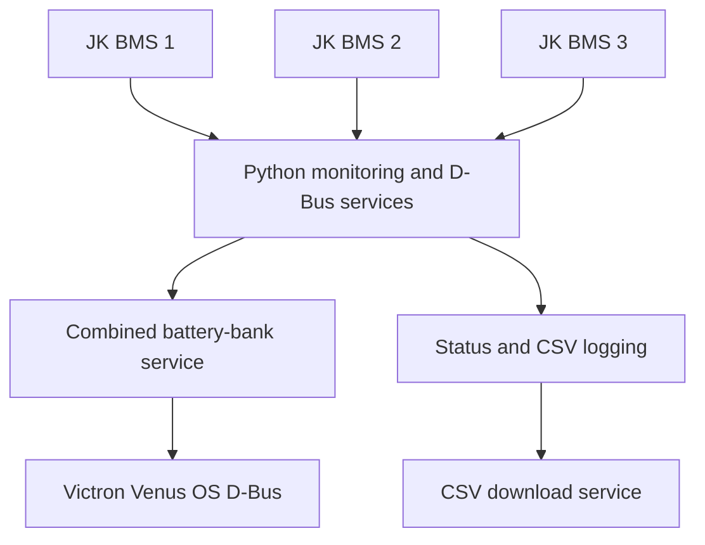

# JK BMS – Victron Venus OS Integration

### Python | Linux | D-Bus | Battery Monitoring | Data Logging

**Independent engineering project — custom JK BMS integration for Victron Cerbo GX.**

## Project overview

Developed a custom software integration for monitoring multiple JK Battery Management Systems (BMS) on Victron Venus OS.

The solution uses Python-based services, D-Bus integration and persistent Linux service configuration to support battery monitoring and data logging.

## Technologies

- **Platform:** Victron Cerbo GX, Venus OS (Linux)
- **Programming:** Python, shell scripting
- **Integration:** Victron D-Bus, VeDbus
- **Services:** Linux service supervision and automatic startup
- **Monitoring:** JK BMS data acquisition, status services
- **Logging:** CSV data logging and download functionality

## Engineering work

- Implemented separate D-Bus services for three JK BMS units.
- Developed a combined battery-bank service.
- Configured a read-only BMS logging service.
- Added status monitoring and CSV logging services.
- Implemented a CSV download service.
- Configured persistent startup through Venus OS `/data/rc.local`.
- Organized custom software under `/data` to support firmware-update persistence.

## System architecture

## Implementation

The system includes three individual JK BMS D-Bus services, a combined bank service, a read-only logger, status monitoring, CSV recording and a download service.

## Documentation

Screenshots of the monitoring interface and service status can be added as supporting evidence.

**Note:** This is a technical portfolio showcase. Complete source code, hardware identifiers, network configuration and private battery data are not published.
